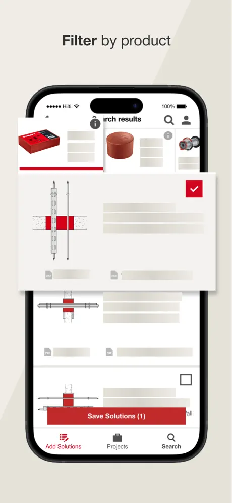
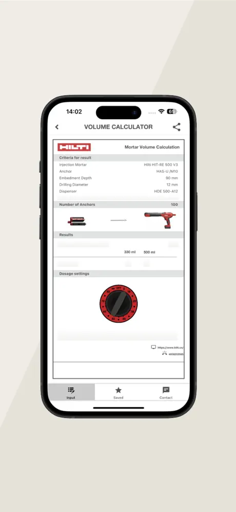
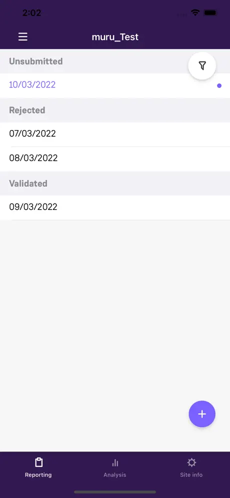
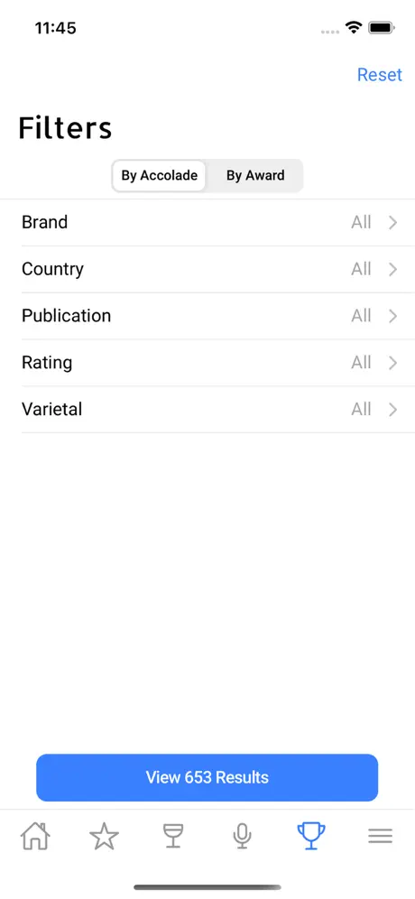
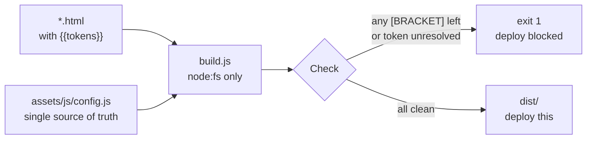

<div align="center">


# Akshay Dixit: Portfolio

**Senior Mobile Engineer & Technical Architect** · .NET MAUI and Xamarin · Offline-first field software

[Live site](https://akshaydixit.com) · [Résumé (PDF)](assets/resume.pdf) · [LinkedIn](https://www.linkedin.com/in/akshaydixit96)

</div>

---

This is the source for my portfolio. I build mobile apps for people who work where there's no
signal, and the site is where I write up that work in detail.

It's plain HTML, one stylesheet (687 lines) and about 100 lines of vanilla JavaScript. A 153-line
build script puts it together, and its only import is `node:fs`. There's no `node_modules`
folder: no React, Tailwind, Vite, PostCSS, web fonts or CDN. The homepage is about 52 KB.

## The work it covers

Four apps I worked on, all on the App Store:

| Hilti Firestop Selector | Hilti Volume Calculator | SmartSite SGRE | Gallo Gateway |
|:---:|:---:|:---:|:---:|
|  |  |  |  |
| Firestop compliance for three regions<br>**.NET MAUI** | Jobsite reference tool<br>**.NET MAUI** | Offline labour reporting<br>**Xamarin.Forms** | Field sales app<br>**Xamarin.iOS** |
| [App Store](https://apps.apple.com/us/app/hilti-firestop-selector/id1663231816) | [App Store](https://apps.apple.com/us/app/hilti-volume-calculator/id722816215) | [App Store](https://apps.apple.com/us/app/smartsite-sgre/id1611744330) | [App Store](https://apps.apple.com/us/app/gallo-gateway/id1018942913) |

Each one has a case study in the same order (Context & Scope, Architectural Blueprint,
Engineering Breakthrough, Scope & Impact) with an SVG architecture diagram I drew by hand. Together
they're about 5,900 words.

There are no links to the source code for these apps. The code belongs to my employers and their
clients, so I can't publish it. The case studies explain the architecture instead, and I'm happy to
go through any of it on a whiteboard.

## Lighthouse results

From a Lighthouse run against the built `dist/`, before Vercel Speed Insights was added:

| Metric | Desktop | Mobile |
|---|:---:|:---:|
| Performance | 100 | 100 |
| Accessibility | 100 | 100 |
| Best Practices | 100 | 100 |
| SEO | 92 | 92 |
| First Contentful Paint | 0.3 s | 1.1 s |
| Largest Contentful Paint | 0.4 s | 1.5 s |
| Total Blocking Time | 0 ms | 0 ms |
| Cumulative Layout Shift | 0 | 0 |

I also checked a few things by hand:

- No horizontal overflow on 9 pages at 375 px and 768 px (`scrollWidth === clientWidth` each time).
- 48 × 48 px tap targets on every standalone control. WCAG only asks for 24 × 24.
- All 20 images have descriptive alt text.
- All 53 external links have `rel="noopener noreferrer"` written into the HTML.

## How it builds

`build.js` reads the source HTML, fills in `{{tokens}}` from one config file, and writes the
result to `dist/`. The config file is only used during the build. It's never copied to `dist/`,
so nobody can read it on the live site.



The check at the end matters most. If any value is still a `[SQUARE_BRACKET]` placeholder, or a
`{{token}}` has no value, the build fails and the error names it. That way a placeholder can't
reach production by accident.

Tokens are filled in at build time, not in the browser. So `<title>`, the canonical link and the
`og:` tags are already correct for crawlers that don't run JavaScript, like LinkedIn, Slack, X,
WhatsApp and Bing.

## Running it locally

```bash
git clone https://github.com/AD-Programmer/My-Portfolio.git
cd My-Portfolio

node build.js                              # writes dist/, exits 1 if anything is unset
python3 -m http.server 8080 --directory dist
open http://localhost:8080
```

There's nothing to install and no lockfile.

**Deploy `dist/`, not the project root.** The root contains `assets/js/config.js`, which is a
build input and shouldn't be served.

<details>
<summary><b>Deploying</b></summary>

<br>

```bash
node build.js && npx vercel --prod dist          # vercel.json carries the security headers
node build.js && netlify deploy --prod -d dist   # _headers carries the security headers
```

Any static host works. GitHub Pages works too, but it can't send custom headers. The CSP
`<meta>` tag on each page still applies, but you lose HSTS, `X-Frame-Options` and
`Permissions-Policy`.

Before the first deploy, check that `siteUrl` in the config, `sitemap.xml`, `robots.txt` and the
JSON-LD block in `index.html` all point at the real domain.

</details>

## Security

A static site doesn't have much to attack, but I locked it down anyway.

| Control | Setting |
|---|---|
| Content Security Policy | `default-src 'self'` on every page. `vercel.json` and the page `<meta>` tags also allow `'unsafe-inline'` scripts and the Vercel vitals host for Speed Insights. `_headers` still has the stricter policy. |
| Third-party JavaScript | None apart from Vercel Speed Insights. No tag manager, no font CDN. |
| Forms | No forms and no backend. `form-action 'none'`. |
| Clickjacking | `frame-ancestors 'none'` and `X-Frame-Options: DENY` |
| External links | `rel="noopener noreferrer"`, written into the HTML |
| Email address | Put together in the browser from split attributes, so it isn't a plain `mailto:` for scrapers |
| `config.js` | Build input only, never deployed |
| HSTS | `max-age=63072000; includeSubDomains; preload` |

<details>
<summary><b>Why the SEO score is 92</b></summary>

<br>

Lighthouse fetches `/robots.txt` from inside the page, and the stricter policy in `_headers` sets
`connect-src 'none'`, which blocks that request, so the `robots-txt` audit fails. I tested it by
changing only that directive to `'self'`, and SEO went from 92 to 100.

Real crawlers fetch `robots.txt` directly, where a page's CSP doesn't apply, and the file returns
`200` with valid content. So this only affects the Lighthouse score. I didn't think it was worth
loosening a real security setting to make a number look better. The reasoning is written down in
[`_headers`](_headers) so nobody "fixes" it later.

</details>

## Design system

The site is dark by default, and the light theme is derived from the dark one. A small script
sets the theme before the page paints, so you never see a flash of the wrong theme.

The brand colours look the same in both themes because each one has a fill token and an ink token:

- `--sig-fill` / `--sig2-fill` are amber and cyan used as a solid background. They're the same
  hex in both themes and always sit under `--on-sig` text, so the contrast never changes.
- `--sig-ink` / `--sig2-ink` are the same colours used as text on the page. These change per
  theme, because text on the page background is a stricter contrast check.

Contrast is checked against `--bg-3`, the hardest surface for contrast that each token actually sits on. Checking
against the page background would understate the risk on raised cards.

| | Amber | Cyan | Background |
|---|---|---|---|
| Dark | `#ffb347` | `#4dd8c0` | `#06080b` |
| Light | `#985900` | `#197465` | `#fbfaf8` |

There are four scales (type, spacing, radius and motion), all taken from values the CSS already
used. The type scale has 9 steps and nothing goes below 12 px. Fonts are system fonts, so there's
no web font request and no layout shift. The full write-up is in
[`design-system/akshay-dixit-portfolio/MASTER.md`](design-system/akshay-dixit-portfolio/MASTER.md).

## Accessibility

I went through the site, found real problems and fixed them:

- `:focus-visible` rings on every interactive element. Nine selectors had none.
- 48 × 48 px touch targets. Hover styles only apply with `@media (hover: hover)` so they don't
  stick on touch screens, and there are `:active` press states instead.
- `scroll-padding-top`, so the sticky nav can't cover a focused anchor.
- Nothing renders below 12 px. Five components did, and I made them bigger.
- Inline links are always underlined, so colour isn't the only signal.
- Semantic landmarks, `aria-current`, table `scope` and `caption`, `.sr-only` and a skip link.
- `prefers-reduced-motion` is respected everywhere, including the press states.

## Project structure

```
├── index.html              Home: intro, summary, featured work, playbook teaser
├── work.html               All four case studies and a career timeline
├── case-hilti.html         Hilti firestop compliance for three regions (SVG diagram)
├── case-smartsite.html     Siemens Gamesa offline timesheets (SVG diagram)
├── case-gallo.html         E. & J. Gallo field sales app (SVG diagram)
├── case-averiq.html        Current role, kept short on purpose
├── playbook.html           What I believe, and MAUI vs React Native vs native
├── stack.html              Tech stack, with how much I've used each item
├── contact.html            Availability, work authorization, time zones, common questions
├── 404.html                Not-found page
│
├── assets/
│   ├── css/main.css        The whole design system, 687 lines
│   ├── js/config.js        The only file to edit (build input, never deployed)
│   ├── js/theme.js         Sets the theme before paint, 16 lines
│   ├── js/site.js          Reveal, nav, email, theme toggle, 83 lines
│   └── shots/              App Store screenshots, WebP, 175 KB total
│
├── build.js                Token replacement and the deploy check, node:fs only
├── _headers                Netlify / Cloudflare Pages security headers
├── vercel.json             Vercel config and security headers
└── dist/                   Build output. This is what you deploy.
```

## Checking a change

```bash
node build.js                                  # must exit 0
grep -rn 'connect-src' dist/index.html         # CSP is still there
grep -c '<img' dist/work.html                  # images are wired up
du -sh dist/assets/shots                       # 12 WebP files, 175 KB
```

Then run Lighthouse against the build and make sure nothing got worse:

```bash
npx lighthouse http://localhost:8080/index.html --preset=desktop --view
```

---

**Open to senior IC and SME roles.** Remote from India, with 4+ hours of overlap with PT, MT, CT
and ET. [Book a call](https://cal.com/akshay-dixit/intro-call) or read the
[availability page](https://akshaydixit.com/contact).
