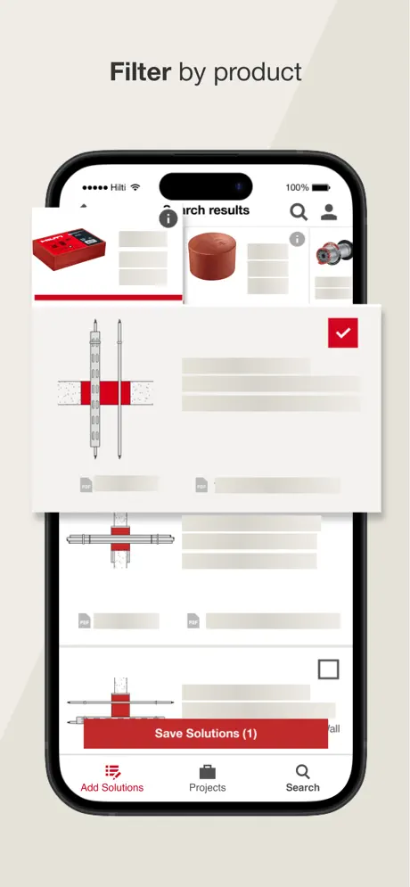
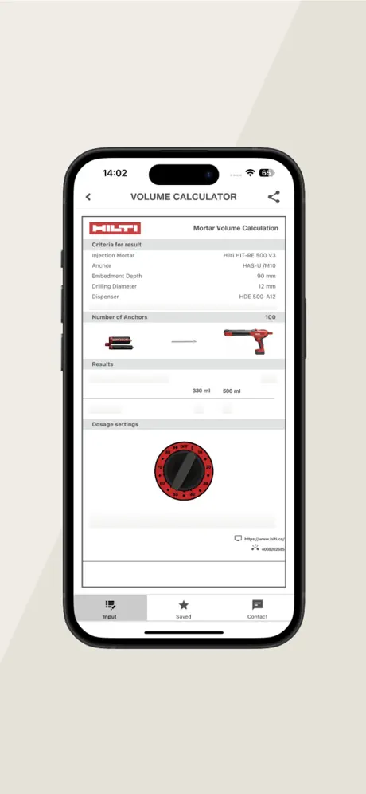
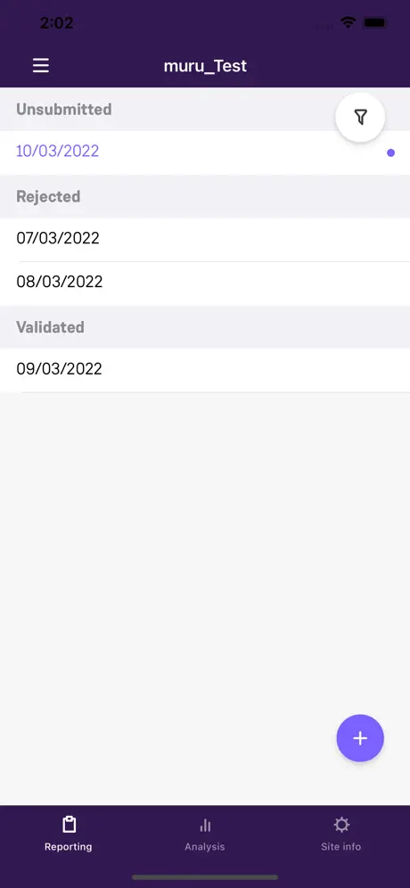
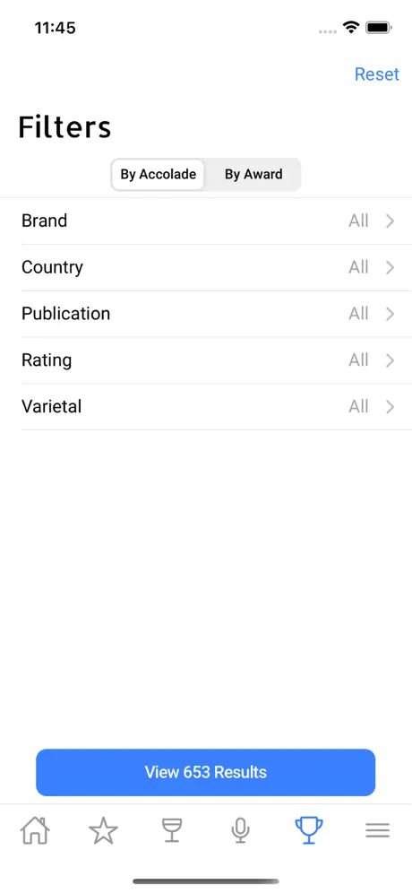
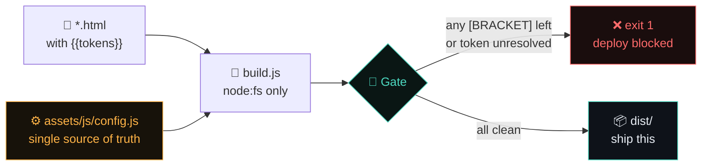

<div align="center">


# Akshay Dixit — Portfolio

### 📵 Mobile systems that hold their state when the network doesn't.

**Senior Mobile Engineer & Technical Architect** · .NET MAUI / Xamarin · Offline-first field software

[](https://akshaydixit.com)
[](assets/resume.pdf)
[](https://www.linkedin.com/in/akshaydixit96)

<br>


</div>

---

## 📦 `node_modules` size

```
0 bytes.
```

There isn't one. No React, no Tailwind, no Vite, no PostCSS, no Google Fonts, no analytics,
no CDN, nothing from npm. 🚫🌐

The whole site is **HTML + one 687-line stylesheet + 99 lines of vanilla JS**, assembled by a
153-line build script whose only import is `node:fs`. A recruiter on hotel Wi-Fi
downloads **52 KB** and sees the page. ⚡

> Portfolios about engineering judgment should demonstrate some. This one is the artifact. 🛠️

---

## 📱 The work it's about

Four shipped applications, all publicly listed on the App Store — verify the product before
reading my account of it.

<div align="center">

| 🔥 Hilti Firestop Selector | 🧮 Hilti Volume Calculator | 🌬️ SmartSite SGRE | 🍷 Gallo Gateway |
|:---:|:---:|:---:|:---:|
|  |  |  |  |
| Multi-region compliance<br>**.NET MAUI** | Jobsite reference tool<br>**.NET MAUI** | Offline labour reporting<br>**Xamarin.Forms** | Field sales enablement<br>**Xamarin.iOS** |
| [App Store ↗](https://apps.apple.com/us/app/hilti-firestop-selector/id1663231816) | [App Store ↗](https://apps.apple.com/us/app/hilti-volume-calculator/id722816215) | [App Store ↗](https://apps.apple.com/us/app/smartsite-sgre/id1611744330) | [App Store ↗](https://apps.apple.com/us/app/gallo-gateway/id1018942913) |

</div>

Each gets a full case study — **Context & Scope → Architectural Blueprint → Engineering
Breakthrough → Scope & Impact** — with a hand-authored SVG architecture diagram. Roughly
**~5,900 words** of real architectural narrative across the four, not a logo wall. 📝

> **🔒 Why there are no repo links on those.** Employer and client code is assigned IP.
> Publishing it would be a breach, so I don't. What's offered instead is the architecture in
> my own words, in depth — plus a whiteboard session any time.

---

## 📊 Measured, not claimed

Every number below came out of an actual Lighthouse run against the built `dist/`, not a vibe. 🎯

| Metric | Desktop | Mobile | 🎖️ |
|---|:---:|:---:|:---:|
| **Performance** | 100 | 100 | 🟢 |
| **Accessibility** | 100 | 100 | 🟢 |
| **Best Practices** | 100 | 100 | 🟢 |
| SEO | 92 | 92 | 🟡 *[by design](#-security-posture)* |
| First Contentful Paint | 0.3 s | 1.1 s | ⚡ |
| Largest Contentful Paint | 0.4 s | 1.5 s | ⚡ |
| Total Blocking Time | 0 ms | 0 ms | 🧊 |
| **Cumulative Layout Shift** | **0** | **0** | 🧊 |

Also verified by hand, because scores don't catch everything:

- ✅ **Zero horizontal overflow** — 9 pages × {375 px, 768 px}, `scrollWidth === clientWidth` every time
- ✅ **48 × 48 px tap targets** on every standalone control (WCAG only asks 24 × 24)
- ✅ **20/20 images** carry descriptive alt text
- ✅ **53/53 external links** carry `rel="noopener noreferrer"` — hardcoded, not JS-applied

---

## 🏗️ How it builds

No bundler. `build.js` walks the source HTML, resolves `{{tokens}}` from a single config
file, and writes `dist/`. The config is a **build input** — it is never copied to the output,
so it is never publicly readable. 🔐



**The gate is the point.** 🚦 Any value still wrapped in `[SQUARE_BRACKETS]`, or any `{{token}}`
with no value behind it, fails the build and names itself in the error. An unverified
placeholder cannot silently reach production — `node build.js && npx vercel --prod` just stops.

Tokens are baked in **at build time**, not hydrated in the browser, so `<title>`,
`<link rel=canonical>` and every `og:` tag are correct for crawlers that don't run
JavaScript — LinkedIn, Slack, X, WhatsApp, Bing, ChatGPT. 🤖

---

## 🚀 Quick start

```bash
git clone https://github.com/AD-Programmer/My-Portfolio.git
cd My-Portfolio

node build.js                              # → dist/   (exits 1 if anything is unset)
python3 -m http.server 8080 --directory dist
open http://localhost:8080
```

No install step. No lockfile. Nothing to be vulnerable. 😌

> **⚠️ Deploy `dist/`, never the project root.** The root contains `assets/js/config.js`,
> which is a build input and must not be served.

<details>
<summary><b>📤 Deploying (click to expand)</b></summary>

<br>

```bash
node build.js && npx vercel --prod dist          # vercel.json carries the security headers
node build.js && netlify deploy --prod -d dist   # _headers carries the security headers
```

Any static host works. GitHub Pages works too, but can't serve custom headers — the per-page
CSP `<meta>` still applies, you just lose HSTS, `X-Frame-Options` and `Permissions-Policy`.

Before the first deploy, confirm `siteUrl` in config, plus `sitemap.xml`, `robots.txt` and the
JSON-LD block in `index.html`, all point at the real domain.

</details>

---

## 🔒 Security posture

Static sites are usually treated as having no attack surface. This one is locked down anyway. 🛡️

| Control | Status |
|---|---|
| 🧱 Strict CSP on every page | `default-src 'self'` — no `unsafe-inline`, no `unsafe-eval` |
| 🚫 Third-party JavaScript | **Zero.** No analytics, no tag manager, no font CDN |
| 📡 Network egress | `connect-src 'none'` — the page cannot phone home |
| 📮 Input surface | No forms, no backend. `form-action 'none'` |
| 🖼️ Clickjacking | `frame-ancestors 'none'` + `X-Frame-Options: DENY` |
| 🔗 External links | `rel="noopener noreferrer"`, hardcoded in the HTML |
| 📧 Email address | Assembled client-side from split attributes — not a scrapeable `mailto:` |
| 🗝️ `config.js` | Build input only. Never deployed, nothing to read |
| 🔐 HSTS | `max-age=63072000; includeSubDomains; preload` |

<details>
<summary><b>🟡 Why SEO is 92, and staying there</b></summary>

<br>

Lighthouse fetches `/robots.txt` **from inside the page**, so `connect-src 'none'` blocks its
probe and the `robots-txt` audit fails. Confirmed by isolating it: relaxing that one directive
to `'self'` — changing nothing else — takes SEO from 92 → 100.

It's a **measurement artifact, not an SEO defect**. Real crawlers request `robots.txt` as a
top-level HTTP fetch, never subject to a page's CSP, and the file serves `200` with valid
content.

This site makes zero `fetch`/XHR calls, so `connect-src 'none'` costs nothing real. Loosening a
genuine exfiltration control to make a scanner number look nicer is the wrong trade. The
reasoning is recorded in [`_headers`](_headers) so it doesn't get "fixed" later. 🙅

</details>

---

## 🎨 Design system

Dark by default, light fully derived — **not an afterthought**. Theme is set pre-paint by a
tiny render-blocking script, so there's no flash of the wrong theme. 🌗

The mechanism that keeps the brand identical across both themes is a **fill / ink split**:

- 🎨 `--sig-fill` / `--sig2-fill` — amber and cyan as a solid **background**. Same hex in both
  themes, only ever paired with `--on-sig` text, so contrast never needs to change.
- 🖋️ `--sig-ink` / `--sig2-ink` — the same hues as **text on the canvas**. These *do* change per
  theme, because text-on-canvas is a stricter check than fill-with-paired-label.

Contrast is verified against **`--bg-3`** — the worst surface each token actually sits on, not
the page canvas, which understates the real risk on raised cards.

| | Amber | Cyan | Canvas |
|---|---|---|---|
| 🌙 Dark | `#ffb347` | `#4dd8c0` | `#06080b` |
| ☀️ Light | `#985900` | `#197465` | `#fbfaf8` |

Four scales — type (9 steps, nothing under 12 px), spacing, radius, motion — all extracted from
values already in use rather than invented. Fonts are **system stacks**: no webfont request, no
layout shift, no CDN. Full documentation in
[`design-system/akshay-dixit-portfolio/MASTER.md`](design-system/akshay-dixit-portfolio/MASTER.md). 📖

---

## ♿ Accessibility

Not a checkbox pass — the failures were found and fixed. 💪

- 🎯 `:focus-visible` rings on **every** interactive element (nine selectors had none)
- 👆 48 × 48 px touch targets; hover gated behind `@media (hover: hover)` so it doesn't stick on
  touch, with `:active` press states instead
- 📏 `scroll-padding-top` so the sticky nav can't cover a focused anchor
- 🔤 Nothing renders below 12 px; five components that did were raised
- 🔗 Persistent underlines on inline links — colour is never the only affordance
- 🏷️ Semantic landmarks, `aria-current`, table `scope`/`caption`, `.sr-only`, skip link
- 🎬 `prefers-reduced-motion` respected globally, including the press states

---

## 📁 Project structure

```
├── index.html              🏠 Hero, proof, featured work, playbook teaser, CTA
├── work.html               💼 All four case studies + career timeline
├── case-hilti.html         🔥 FLAGSHIP — multi-region firestop compliance   (SVG diagram)
├── case-smartsite.html     🌬️ Siemens Gamesa — offline-first timesheets     (SVG diagram)
├── case-gallo.html         🍷 E. & J. Gallo — field sales enablement        (SVG diagram)
├── case-averiq.html        🚧 Current role — deliberately short
├── playbook.html           🧭 SME philosophy + MAUI vs RN vs Native
├── stack.html              🧰 Tech stack, annotated by honest depth of use
├── contact.html            📬 Availability, work auth, timezone, screening Q&A
├── 404.html                🕳️ Styled not-found page
│
├── assets/
│   ├── css/main.css        🎨 The entire design system — 687 lines
│   ├── js/config.js        ⚙️ THE ONLY FILE TO EDIT  (build input, never deployed)
│   ├── js/theme.js         🌗 Pre-paint theme, 16 lines
│   ├── js/site.js          ✨ Reveal, nav, mail obfuscation, theme toggle — 83 lines
│   └── shots/              📱 App Store screenshots, WebP, 175 KB total
│
├── build.js                🔧 Token resolution + deploy gate. node:fs only
├── _headers                🛡️ Netlify / Cloudflare Pages security headers
├── vercel.json             🛡️ Vercel security headers
└── dist/                   📦 Build output — THIS is what you deploy
```

---

## 🧪 Verifying a change

```bash
node build.js                                  # must exit 0 — the gate is the check
grep -rn 'connect-src' dist/index.html         # CSP intact
grep -c '

## 🤝 Hiring for a mobile surface nobody currently owns?

**Open to senior IC / SME roles** · Remote from India · 4+ hours overlap with PT / MT / CT / ET

[](https://cal.com/akshay-dixit/intro-call)
[](https://akshaydixit.com/contact)

<br>

<sub>Built with HTML, CSS, and a refusal to install anything. 🧘</sub>

</div>
